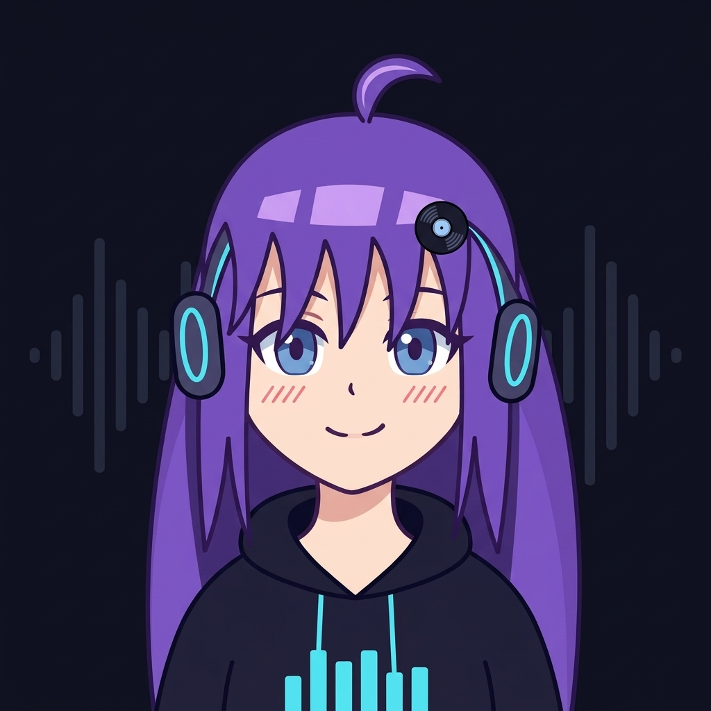
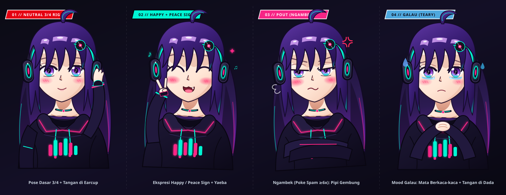

<div align="center">
  

  # 🎵 IsThisOurJukebox V2

  ### Zero-Friction Standalone Office Radio & Collaborative LAN Jukebox
  *“Wait... is this our jukebox?” — Yes, yes it is.*

  <br />

  [](https://bun.sh)
  [](https://hono.dev)
  [](https://vuejs.org)
  [](https://tailwindcss.com)
  [](LICENSE)
</div>

---

## 💭 Why I Built This (The Backstory)

> *"In my office, we often listen to music together and love vibing throughout the workday.*
>
> *Naturally, coworkers would constantly shout out or message song requests: **'Hey, play this song!'**, **'Can you queue that one next?'**, **'Skip this please!'**.*
>
> *While I genuinely loved listening to music and enjoying the vibe together, constantly stopping whatever I was working on, switching tabs, searching YouTube, and managing the playlist became quite distracting.*
>
> *I needed a solution where everyone could enjoy our shared office tunes seamlessly without pulling anyone out of their focus. That's how **IsThisOurJukebox** was born—a zero-friction, standalone office jukebox where anyone on our office Wi-Fi can simply scan a QR code from their phone, search for songs, queue up tracks, and democratically upvote favorites in real-time, all without touching the host laptop or interrupting the person plugged into the speakers!"*

---

## ✨ Key Features

### 🎶 Core Jukebox
- 📱 **Zero Setup / Account-Free for Coworkers**:
  No downloads or accounts needed. Coworkers scan the on-screen QR code (or visit the office LAN IP), choose a display nickname (or stay anonymous), and start requesting.
- 🎧 **Dedicated Host Studio Dashboard**:
  Run a single binary on the speaker laptop. It automatically opens the browser to the authenticated **Host Studio** (`/#/host?token=...`) with audio output, tactile visualizers, and playback master controls.
- 🗳️ **Democratic Voting & Smart Queue**:
  Coworkers can upvote queued tracks. Songs with the highest votes automatically bubble to the top of the playlist.
- 🎧 **Personal Headphone Mode ("Silent Disco / Tune In")**:
  Coworkers wearing headphones or earbuds can tap **"Tune In"** directly on their phones or laptops to stream the shared office queue in real-time sync with personal volume control, mobile lock-screen & Bluetooth controls (MediaSession API), and intelligent micro-drift clock correction without disturbing the office speakers.
- 🚀 **Direct Audio Stream Proxy (No YouTube Iframe / Error 150/101)**:
  Unlike fragile YouTube embeds that Google blocks on office networks, V2 resolves audio through a high-performance **Direct Audio Stream Proxy** (`/api/stream/:id`) feeding a standard HTML5 `<audio>` element with HTTP Range support (`206 Partial Content`) and instant playback failover.
- 📻 **Smart Auto-Radio DJ**:
  When the queue runs out, Auto-DJ automatically curates and queues matching vibes based on recent office favorites so the room is never dead silent.
- 🎤 **Synchronized Live Lyrics & Visualizer**:
  Real-time synchronized, syllable-highlighted karaoke lyrics display and a live frequency spectrum visualizer with ambient album art glow.
- 🔒 **Role-Based Remote Access**:
  - **Host**: Master DJ connected directly to the office speakers.
  - **DJ**: Coworkers who unlock DJ mode with a passcode to pause, play, or scrub from their phones.
  - **Members**: Office listeners requesting, upvoting, and enjoying the music.

### 🎮 Office Arcade (Party Games)
- 🎵 **Tebak Lagu / Trivia Song-Guess Multiplayer**:
  Host-gated party game. The Host picks a curated genre preset (Pop Indo, Indie Indo, Rock Indo, …) or pastes a YouTube Music playlist URL (validated live via `POST /api/trivia/preview-playlist`), chooses rounds (5/10/15) and snippet length (10/20/30s), then starts. Players get a lobby invite, toggle ready, guess from 4 multiple-choice `Judul – Artis` options while a 20–30s snippet streams via `/api/stream/:id`. Fastest-correct answers earn speed-bonus points, with per-round recaps and a Top-3 podium. Room music auto-pauses and resumes afterwards. Sources include current queue vibes, office history, genre presets, and custom playlists (SQLite-cached, 12h TTL).
- 🎹 **osu!mania 4-Key Rhythm Game** *(currently hidden — in polish)*:
  4-lane rhythm gameplay (`D F J K`, remappable + touch) synced to the now-playing track. Deterministic seeded beatmaps per `trackId + difficulty (easy/normal/hard)`, timing windows down to 22ms for MAX, combo/score/accuracy/grade (`SS/S/A/B/C/D`), floating judges + hit FX, and persistent SQLite leaderboards (per-track Top-10, all ranked songs, global Hall of Fame with live `#1` toast). Re-enable by setting `SHOW_OSU_MODE = true` in `frontend/src/shared/config.ts`.
- 🕹️ **Persona 5 Arcade Hub Skin**:
  `OFFICE ARCADE // MINIGAME CENTER` modal with featured cards for Tebak Lagu, Rhythm 4K, and Leaderboards — plus slanted red/cyan P5 command ribbons, HP/SP-style Now-Playing gauges, and a full-screen Battle Stage layout. Pure Tailwind (`p5-*` utilities), no gameplay logic changes.

### 💜 Social & Mascot
- 🎭 **Juke-chan Mood DJ Mascot** — meet her [below](#-meet-juke-chan--our-resident-mood-dj):
  Reactive Live2D-style SVG mascot driven by a beat driver (real FFT onset + per-mood fallback BPM) and a `hype / lofi / romance / galau` mood engine. Backend enriches every track with genre/mood via MusicBrainz (+ optional Last.fm) into `track_metadata_cache`; frontend falls back to keyword/artist + bass-energy detection. She bounces to the kick, speaks contextual lines (member joined, track requested/upvoted/skipped, karaoke toggled), reacts to emoji combo surges, gets poked/annoyed/sulky, and falls asleep after ~90–150s idle. Includes WebAudio synth SFX (mood jingles, voice blips, per-zone taps).
- 🎉 **Per-Emoji Reaction Combos + Synth Sound**:
  Each emoji has its own independent combo counter with adaptive decay (1.8s → 3.0s) and milestone (`every 5 past 10`) / climax (`100+` + 3s lockout) broadcasts. Pentatonic pitch rises with combo, with distinct per-emoji timbre. 60-char shoutouts with 2.5s rate-limit.
- 📦 **100% Standalone Single Binary**:
  Frontend, backend, SQLite history, and embedded assets are bundled into a single ~87 MB executable (`jukebox-office.exe`). Zero external dependencies required.

---

## 💜 Meet Juke-chan — Our Resident Mood DJ

<div align="center">
  

  *“Ehehe~ Juke-chan yang jaga booth hari ini! Request lagu yang bagus ya~ 🎧✨”*
</div>

**Juke-chan** is the soul of the jukebox — a headphone-wearing DJ girl with long purple hair, neon-cyan earcups, a music-note ahoge (antenna!), and a sailor top with a live equalizer that pulses to the room's music. She lives on every screen, bounces to the kick drum, and always has something to say — in playful Indonesian mixed with English lyric quotes. The sheet above is her actual vector artboard (`assets/jukechan.svg`) — all four canon expressions, drawn to match her in-app rig.

### 🌈 Four moods, four Juke-chans

Her outfit glow, stage lighting, bounce speed, and even her greetings shift with whatever is playing — detected from backend genre/mood tags (MusicBrainz + optional Last.fm), falling back to title/artist keywords and live bass-energy analysis:

| Mood | Badge | Vibe | You'll hear her say… |
|---|---|---|---|
| ⚡ **Hype** | Electronic Hype | Fast, loud, party bangers — neon purple stage, 0.45s bounce | *“DROP THE BEAT! Lagu ini enerjik banget, ayo goyang semuanya! 🔥⚡”* |
| ☕ **Lo-Fi** | Midnight Lo-Fi | Chill, rain, study beats — deep blue room, slow sway | *“Suasana tenang terdeteksi... paling enak kerja sambil dengerin vibes ini ☕🌧️”* |
| 🌸 **Romance** | Sweet City Pop | Love songs & city pop — warm pink glow | *“Aww melodinya manis banget! Siapa nih yang lagi jatuh cinta? 💖🌸”* |
| 🌧️ **Galau** | Sad Indie Acoustic | Sad acoustic & heartbreak ballads — teary eyes, hand on chest | *“Liriknya dalem banget... sini nemenin Juke-chan, jangan sedih sendirian ya 🥺🌧️”* |

### 😤 She's interactive (go ahead, poke her)

- **Pat her head** → happy purrs (*“Ehehe~ dielus-elus gini bikin Juke-chan makin semangat nge-DJ!”*)
- **Pinch her cheek / flick her ahoge** → flustered protests (*“Itu antena sinyal musik, jangan disentil dong! ⚡”*)
- **Poke-spam her 6× in 3 seconds** → she **pouts (ngambek)** for 5s with puffed cheeks and crossed arms — keep poking and the sulk timer extends!
- **Leave her alone ~90s** → she gets drowsy; **~150s** → fast asleep with `zzz` bubbles (but she *never* sleeps while music is playing — tap her to wake her up).
- **Spam emoji reactions** → she dances, cheers, and calls out combos (*“🔥 COMBO x50! ULTRA BASS SURGE!!”*); each emoji family has its own line, from air-guitar solos to heart-hands.
- **Room events** → she welcomes newcomers by name, celebrates new queue requests/upvotes, gasps when a track is skipped, and hands you the mic when Karaoke mode turns on.

Under the hood she's a full Live2D-style SVG rig (`JukeChanRig.vue` + spring physics + beat driver + typewriter speech with voice blips), with 20+ gestures, 19 dialogue categories, particle FX (notes, hearts, sparkles, confetti, fire), and per-mood WebAudio jingles — all in `frontend/src/shared/jukechan/` + `useJukeChanMood.ts`.

---

## ⚡ What Was Fixed in V2

1. **Eliminated YouTube Copyright / Iframe Errors (Error 150/101)**:
   - Replaced all `iframe` embeds with native direct streaming.
2. **Zero-Stutter Seamless Fallback**:
   - Background audio validation ensures that broken streams immediately fail over to playable alternatives without infinite skip loops.
3. **Optimized Multi-Client WebSocket Architecture**:
   - Sub-10ms state synchronization for queue updates, votes, playback progress, and member rosters.
4. **Emil Kowalski-Grade Tactile UI**:
   - Polished responsive mobile drawer, micro-interactions, dark aesthetic, and haptic feedback.
5. **Office Arcade Update** (undocumented until now):
   - Trivia multiplayer, hidden Rhythm 4K mode, Persona 5 arcade skin, Juke-chan mascot with metadata-driven moods, and per-emoji reaction combos.

---

## 🚀 Quick Start (For Host DJ)

1. Double-click `jukebox-office.exe` on the computer connected to the office sound system / speakers.
2. The server starts and **automatically opens your default browser** to the **Host DJ Studio** (`http://<LAN-IP>:3000/#/host?token=...`).
3. Turn on the speakers.
4. Coworkers scan the on-screen QR code on their smartphones (or navigate to `http://<LAN-IP>:3000`) to start adding songs!

### 🎮 Starting a Trivia Night
1. In Host Studio, open **Office Arcade → Tebak Lagu**.
2. Pick a **Preset** (curated category) or **Custom** (paste a YouTube Music playlist URL — it validates live).
3. Choose rounds (5/10/15) and snippet length (10/20/30s), then **Start**.
4. Players tap the lobby invite → toggle **Ready** → guess fast for bonus points!

---

## 🛠️ Developer Guide

Built with **Bun v1.2+**, **Hono**, **SQLite**, and **Vue 3 / Vite**.

### Prerequisites
- [Bun](https://bun.sh/) (v1.2 or higher)

### Setup & Commands

```bash
# Clone the repository
git clone https://github.com/username/IsThisOurJukeboxV2.git
cd IsThisOurJukeboxV2

# Install dependencies
bun install

# Run development mode (Hot-Reload frontend + backend)
bun run dev

# Run type checking across backend and frontend
bun run typecheck

# Run automated end-to-end WebSocket & streaming smoke tests
# (now covers per-emoji combo isolation)
bun run smoke:ws

# Run trivia flow smoke test (boots server on :3088, checks
# categories / presets / preview / create / join / answer)
bun run smoke:trivia

# Build and package single standalone Windows binary
bun run package
# -> Outputs ./jukebox-office.exe (~87 MB)
```

| Script | What it does |
|---|---|
| `bun run dev` | Builds frontend + manifest, then runs backend + frontend concurrently |
| `bun run typecheck` | `tsc` (backend) + `vue-tsc` (frontend) |
| `bun run smoke:ws` | WebSocket + streaming smoke test (per-emoji isolation) |
| `bun run smoke:trivia` | Trivia categories/presets/preview/game-flow smoke test |
| `bun run manifest` | Regenerates embedded asset manifest (`scripts/build-manifest.ts`) |
| `bun run tunnel:quick` / `tunnel:named` | Cloudflare Tunnel orchestrators (see below) |
| `bun scripts/fetch-trivia-ids.ts` | Bulk-mints verified trivia song IDs into `scripts/verified-trivia-songs.json` |

### ⚙️ Configuration (`.env`)

Copy `.env.example` to `.env`:

```env
JUKEBOX_PORT=3000
TUNNEL_MODE=quick
# PUBLIC_URL=https://jukebox.yourdomain.com
# CLOUDFLARE_TUNNEL_TOKEN=eyJh...
ALLOW_REMOTE_AUDIO=true
# LASTFM_API_KEY=...        # optional: enriches track mood tags (MusicBrainz + Last.fm)
# JUKEBOX_DB_PATH=./data/jukebox.db  # SQLite path (default shown)
```

| Var | Default | Notes |
|---|---|---|
| `JUKEBOX_PORT` | `3000` | Local listen port |
| `TUNNEL_MODE` | `quick` | `named` \| `quick` \| `off` |
| `PUBLIC_URL` | — | Permanent domain for named tunnels |
| `CLOUDFLARE_TUNNEL_TOKEN` | — | Connector token for `tunnel:named` |
| `ALLOW_REMOTE_AUDIO` | `true` | `false` = controller-only remotes (live-toggleable by Host) |
| `LASTFM_API_KEY` | — | Optional; without it, mood tags come from MusicBrainz only |
| `JUKEBOX_DB_PATH` | `./data/jukebox.db` | Tables: queue/playback/stats + `rhythm_beatmaps`, `rhythm_scores`, `track_metadata_cache`, `trivia_presets` |

> Rhythm mode visibility: set `SHOW_OSU_MODE = true` in `frontend/src/shared/config.ts` to re-enable osu! buttons (hidden by default while in polish).

### 🔌 API & WebSocket Reference (summary)

**REST** (`backend/src/server.ts`):
`GET /api/whoami`, `POST /api/tunnel/register`, `GET /api/lyrics`, `GET /api/tracks/top|recent|related`, `GET /api/search`, `GET /api/stream/:id` (Range/206, `403` for remotes when `ALLOW_REMOTE_AUDIO=false`), `GET /api/trivia/categories`, `GET|POST /api/trivia/presets`, `DELETE /api/trivia/presets/:id`, `POST /api/trivia/presets/:id/sync`, `POST /api/trivia/preview-playlist`, `GET /api/rhythm/beatmap/:trackId`, `GET /api/rhythm/leaderboard/:trackId|songs|global`, `POST /api/rhythm/score`.

**WS Client → Server**: `hello`, `setNickname`, `requestTrack`, `upvoteTrack`, `removeVote`, `timeUpdate`, `trackEnded`, `trackError`, `setRole`, `claimRole`, `setDjPasscode`, `play`, `pause`, `skip`, `seek`, `volume`, `removeTrack`, `toggleAutoDj`, `setOutputMode`, `setKaraokeMode`, `toggleRemoteAudio`, `setListening`, `reaction`, `shoutout`, + trivia `trivia:create|join|leave|ready|setHostPlaying|forceStart|audioReady|answer|close`.

**WS Server → Client**: `welcome`, `stateSync`, `timeUpdate`, `seek`, `queueUpdated`, `nowPlayingUpdated`, `historyUpdated`, `roleGranted`, `toast`, `reactionBroadcast`, `comboReset`, `shoutoutBroadcast`, `rhythmScoreBroadcast`, + trivia `trivia:stateSync|lobbyCreated|roundStart|timerStart|roundEnd|gameOver|closed|presetsUpdated`.

---

## 🌐 Public Internet Access & Cloudflare Tunnel

IsThisOurJukebox V2 natively supports zero-port-forwarding public exposure via **Cloudflare Tunnel**, allowing remote coworkers or mobile phones on cellular data to connect seamlessly:

### 1. Ephemeral Quick Tunnel (Zero Account Needed)
Generate an instant, temporary public URL without needing a Cloudflare account or domain:
```bash
# Automated orchestrator (launches tunnel and registers QR code automatically)
bun run tunnel:quick

# Or for standalone binary users:
# Double-click start-with-quick-tunnel.bat
```

### 2. Named Tunnel with Custom Domain (Production Office Setup)
Route a permanent branded hostname (e.g. `https://jukebox.yourdomain.com`) directly to your office host machine:
1. Copy `.env.example` to `.env` and set:
   ```env
   TUNNEL_MODE=named
   PUBLIC_URL=https://jukebox.yourdomain.com
   ```
2. In the [Cloudflare Zero Trust Dashboard](https://one.dash.cloudflare.com/), create a tunnel named `office-jukebox` and map your public hostname to `http://localhost:3000`.
3. Start the jukebox with `bun run dev`, `bun run tunnel:named`, or `start-with-named-tunnel.bat`.

### 🛡️ Bandwidth Saver Mode (Host Upload Protection)
- **Controller Traffic**: Song searches, queuing, upvoting, live lyrics, and reactions use **< 10 MB / hour** total across all users (<0.1% upload).
- **Personal Audio Streams ("Tune In")**: Each headphone listener downloads ~58 MB/hour.
- **Upload Protection**: The Host DJ can toggle **"Remote Headphone Audio"** in the Host Studio (or set `ALLOW_REMOTE_AUDIO=false` in `.env`). When disabled, coworkers can still queue, vote, and sing along to the office room speakers without using any of the host's internet upload bandwidth.

---

## 🔒 Network & Security Note

- **Host Controls Protection**: The Host Studio requires a secret admin token (`/#/host?token=...`). Public QR codes and coworker URLs never expose this secret token.
- **Brute-Force Rate Limiting**: DJ passcode verification is protected by an in-memory rate limiter (max 5 failed attempts per client/IP per 2 minutes).
- **Rhythm anti-cheat**: Score submissions are sanity-capped server-side (`score <= notes * 350 * 5 + 5000`).
- **Real IP Logging**: The server natively resolves `CF-Connecting-IP` behind Cloudflare Tunnels to track unique remote clients accurately.

---

## ⚖️ Legal Disclaimer

This software is an open-source project developed strictly for **educational and personal LAN jukebox purposes**. 
- It does **not** host, store, cache permanently, or redistribute any copyrighted audio or media files.
- Audio streams are dynamically resolved from publicly accessible third-party services.
- Trivia presets cache only track IDs/metadata (12h TTL), not audio.
- All trademarks, logos, and copyrights belong to their respective owners. Please respect the terms of service of the content providers you access.

---

## 📄 License

This project is open-sourced under the [MIT License](LICENSE).
