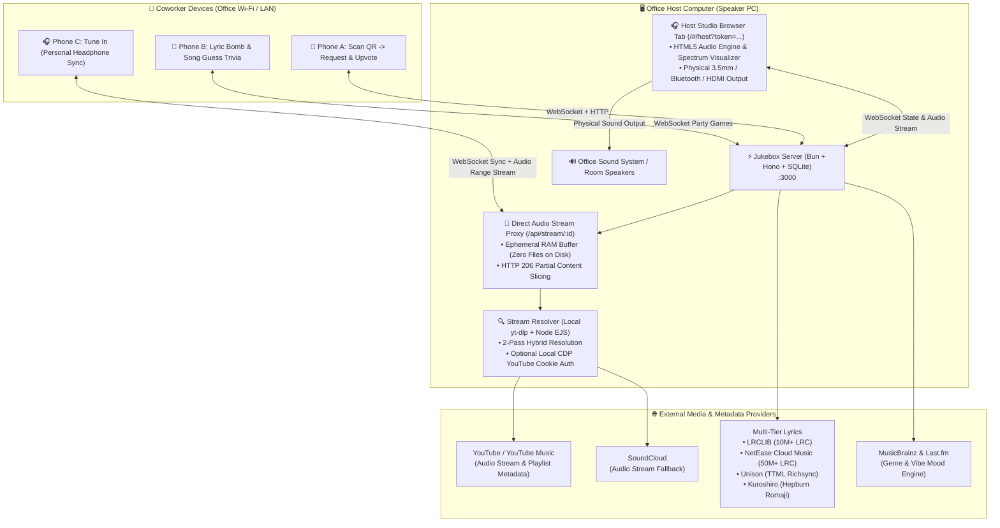

<div align="center">
  

  # 🎵 IsThisOurJukebox V2

  ### Zero-Friction Standalone Office Radio & Collaborative LAN Jukebox
  *“Wait... is this our jukebox?” — Yes, yes it is.*

  <br />

  [](https://bun.sh)
  [](https://hono.dev)
  [](https://vuejs.org)
  [](https://tailwindcss.com)
  [](LICENSE)
</div>

---

## 💭 Why I Built This (The Backstory)

> *"In my office, we often listen to music together and love vibing throughout the workday.*
>
> *Naturally, coworkers would constantly shout out or message song requests: **'Hey, play this song!'**, **'Can you queue that one next?'**, **'Skip this please!'**.*
>
> *While I genuinely loved listening to music and enjoying the vibe together, constantly stopping whatever I was working on, switching tabs, searching YouTube, and managing the playlist became quite distracting.*
>
> *I needed a solution where everyone could enjoy our shared office tunes seamlessly without pulling anyone out of their focus. That's how **IsThisOurJukebox** was born—a zero-friction, standalone office jukebox where anyone on our office Wi-Fi can simply scan a QR code from their phone, search for songs, queue up tracks, and democratically upvote favorites in real-time, all without touching the host laptop or interrupting the person plugged into the speakers!"*

---

## 📐 Architecture & How It Works

IsThisOurJukebox V2 is architected specifically as a **Private Local Area Network (LAN) / Intranet utility**. The computer physically connected to the office sound system acts as both the lightweight server and the playback engine, while coworkers interact through mobile web browsers on the same local network:



---

## ✨ Key Features

### 🎶 Core Jukebox
- 📱 **Zero Setup / Account-Free for Coworkers**:
  No downloads or accounts needed. Coworkers scan the on-screen QR code (or visit the office LAN IP), choose a display nickname (or stay anonymous), and start requesting.
- 🎧 **Dedicated Host Studio Dashboard**:
  Run a single binary on the speaker laptop. It automatically opens the browser to the authenticated **Host Studio** (`/#/host?token=...`) with audio output, tactile visualizers, and playback master controls.
- 🗳️ **Democratic Voting & Smart Queue**:
  Coworkers can upvote queued tracks. Songs with the highest votes automatically bubble to the top of the playlist.
- 🎧 **Personal Headphone Mode ("Silent Disco / Tune In")**:
  Coworkers wearing headphones or earbuds can tap **"Tune In"** directly on their phones or laptops to stream the shared office queue in real-time sync with personal volume control, mobile lock-screen & Bluetooth controls (MediaSession API), and intelligent micro-drift clock correction without disturbing the office speakers.
- 🚀 **Direct Audio Stream Proxy (No YouTube Iframe / Error 150/101)**:
  Unlike fragile YouTube embeds that Google blocks on office networks, V2 resolves audio through a high-performance **Direct Audio Stream Proxy** (`/api/stream/:id`) feeding a standard HTML5 `<audio>` element with HTTP Range support (`206 Partial Content`), pure in-memory buffering (`memoryBuffer.ts`), and instant playback failover. **Zero audio files are saved or cached to disk.**
- 📻 **Smart Auto-Radio DJ**:
  When the queue runs out, Auto-DJ automatically curates and queues matching vibes based on recent office favorites so the room is never dead silent.
- 🎤 **5-Tier Synchronized Lyrics & Japanese Romaji Engine**:
  Real-time synchronized karaoke lyrics powered by a multi-provider fallback engine:
  1. **Unison**: High-fidelity YouTube Music TTML syllable-synced lyrics.
  2. **LRCLIB**: 10M+ open synchronized LRC database.
  3. **NetEase Cloud Music (163 Music)**: 50M+ millisecond-timestamped synchronized lyrics.
  4. **Kugou**: Public synchronized LRC repository.
  5. **lyrics.ovh**: Plaintext lyric safety fallback.
  - 🇯🇵 **Phonetic Romaji Conversion**: Automatically transcribes Japanese kanji/hiragana/katakana lyrics into Hepburn Romaji using Kuroshiro and Kuromoji so everyone in the room can sing along!
- 🍪 **In-App YouTube Cookie Authentication (`CDP`)**:
  A built-in Host Studio modal that launches a lightweight browser session via Chrome DevTools Protocol (CDP), allowing the Host to log in to YouTube/YouTube Music locally. It exports clean Netscape `cookies.txt` into the local `data/` folder, completely bypassing YouTube bot detection (HTTP 429 *"Sign in to confirm you're not a bot"*) and age restrictions on the local network.
- 🔒 **Role-Based Remote Access**:
  - **Host**: Master DJ connected directly to the office speakers, protected by a cryptographically secure 256-bit token (`data/admin-token.txt`).
  - **DJ**: Coworkers who unlock DJ mode with a passcode to pause, play, or scrub from their phones (protected by an in-memory brute-force rate limiter).
  - **Members**: Office listeners requesting, upvoting, and enjoying the music.
- 🛡️ **Bandwidth Saver Mode**:
  Host can toggle **"Remote Headphone Audio"** in the Host Studio (or set `ALLOW_REMOTE_AUDIO=false` in `.env`). When active, coworkers can still search, queue, vote, and play arcade games, but personal audio streaming is restricted to preserve the host machine's internet bandwidth.
- 🔄 **Persistent Client Identity & WebSocket Heartbeat**:
  Client IDs persist across mobile browser refreshes in `localStorage`. Reconnections restore member roles, votes, and game states automatically with bidirectional WebSocket `ping`/`pong` keepalive monitoring.

---

### 🎮 Office Arcade (Party Games)

- 💣 **Lyric Bomb (Hot Potato Multiplayer)**:
  An interactive elimination party game with lives and a ticking time-bomb. Players take turns arranging word chunks from the currently playing song's lyrics when the music suddenly stops. Whoever holds the bomb must tap the correct word sequence before it explodes in their hands!
  - **Mechanics**: Wrong word taps deduct penalty time (-1.5s). On success, the music resumes and the bomb is tossed to the next player with an increasingly shorter fuse.
  - **Team Victory**: Surviving the entire song awards every surviving player a **+1 bonus life (HP)**!
  - **Playlist Sources**: Play with the current room queue, curated office presets, or search any song (validated in real-time for time-synced lyrics).
- 🎵 **Song Guess (Trivia Multiplayer)**:
  Host-gated party game. The Host picks a curated genre preset (Pop Indo, Indie Indo, Rock Indo, Anime, 2000s Hits, …) or pastes a YouTube Music playlist URL (validated live via `POST /api/trivia/preview-playlist`), chooses rounds (5/10/15) and snippet length (10/20/30s), then starts. Players get a lobby invite, toggle ready, and guess from 4 multiple-choice options while a snippet streams via `/api/stream/:id`. Fastest-correct answers earn speed-bonus points, with per-round recaps, audio issue reporting, host question skipping, and a Top-3 podium. Room music auto-pauses and resumes afterwards.
- 🎹 **osu!mania 4-Key Rhythm Game** *(in polish — toggleable)*:
  4-lane rhythm gameplay (`D F J K`, remappable + touch) synced to the now-playing track. Deterministic seeded beatmaps per `trackId + difficulty (easy/normal/hard)`, timing windows down to 22ms for MAX, combo/score/accuracy/grade (`SS/S/A/B/C/D`), floating judges + hit FX, server-side anti-cheat sanity checks, and persistent SQLite leaderboards. Re-enable by setting `SHOW_OSU_MODE = true` in `frontend/src/shared/config.ts`.
- 🕹️ **Persona 5 Arcade Hub Skin & Web Audio FX**:
  `OFFICE ARCADE // MINIGAME CENTER` modal with featured cards for Song Guess, Lyric Bomb, Rhythm 4K, and Leaderboards. Features slanted red/cyan P5 command ribbons, HP/SP-style Now-Playing gauges, full-screen battle stage layouts, and responsive Web Audio synthesized UI sound effects (click clicks, ribbon whooshes, and confirmations).

---

### 💜 Social & Mascot

- 🎭 **Juke-chan Mood DJ Mascot** — meet her [below](#-meet-juke-chan--our-resident-mood-dj):
  Reactive Live2D-style SVG mascot driven by real 60fps kinematics, a beat driver (real FFT onset + per-mood fallback BPM), and a `hype / lofi / romance / galau` mood engine. Backend enriches every track with genre/mood via MusicBrainz (+ optional Last.fm) into `track_metadata_cache`; frontend falls back to keyword/artist + bass-energy detection. She bounces to the kick, speaks contextual lines (member joined, track requested/upvoted/skipped, karaoke toggled), reacts to emoji combo surges, gets poked/annoyed/sulky, and falls asleep after ~90–150s idle. Includes WebAudio synth SFX (mood jingles, voice blips, per-zone taps).
- 🎉 **Per-Emoji Reaction Combos + Synth Sound**:
  Each emoji has its own independent combo counter with adaptive decay (1.8s → 3.0s) and milestone (`every 5 past 10`) / climax (`100+` + 3s lockout) broadcasts. Pentatonic pitch rises with combo, with distinct per-emoji timbre. 60-char shoutouts with 2.5s rate-limit.
- 📦 **100% Standalone Single Binary**:
  Frontend, backend, SQLite history, and embedded assets are bundled into a single ~87 MB executable (`jukebox-office.exe` on Windows, `jukebox-office` on macOS & Linux). Zero external dependencies required.

---

## 💜 Meet Juke-chan — Our Resident Mood DJ

<div align="center">
  

  *“Ehehe~ Juke-chan is on booth duty today! Request some good songs, okay~ 🎧✨”*
</div>

**Juke-chan** is the soul of the jukebox — a headphone-wearing DJ girl with long purple hair, neon-cyan earcups, a music-note ahoge (antenna!), and a sailor top with a live equalizer that pulses to the room's music. She lives on every screen, bounces to the kick drum, and always has something to say — playful DJ banter sprinkled with lyric quotes. The sheet above is her actual vector artboard (`assets/jukechan.svg`) — all four canon expressions, drawn to match her in-app rig.

### 🌈 Four moods, four Juke-chans

Her outfit glow, stage lighting, bounce speed, and even her greetings shift with whatever is playing — detected from backend genre/mood tags (MusicBrainz + optional Last.fm), falling back to title/artist keywords and live bass-energy analysis:

| Mood | Badge | Vibe | You'll hear her say… |
|---|---|---|---|
| ⚡ **Hype** | Electronic Hype | Fast, loud, party bangers — neon purple stage, 0.45s bounce | *“DROP THE BEAT! This song is pure energy, everybody dance! 🔥⚡”* |
| ☕ **Lo-Fi** | Midnight Lo-Fi | Chill, rain, study beats — deep blue room, slow sway | *“Calm vibes detected... this is the coziest way to work with these sounds on ☕🌧️”* |
| 🌸 **Romance** | Sweet City Pop | Love songs & city pop — warm pink glow | *“Aww, this melody is so sweet! Who's falling in love out there? 💖🌸”* |
| 🌧️ **Galau** | Sad Indie Acoustic | Sad acoustic & heartbreak ballads — teary eyes, hand on chest | *“The lyrics cut so deep... come sit with Juke-chan, don't be sad all alone, okay? 🥺🌧️”* |

### 😤 She's interactive (go ahead, poke her)

- **Pat her head** → happy purrs (*“Ehehe~ head pats like this make Juke-chan even more hyped to DJ!”*)
- **Pinch her cheek / flick her ahoge** → flustered protests (*“That's my music-signal antenna, don't flick it! ⚡”*)
- **Poke-spam her 6× in 3 seconds** → she **pouts and sulks** for 5s with puffed cheeks and crossed arms — keep poking and the sulk timer extends!
- **Leave her alone ~90s** → she gets drowsy; **~150s** → fast asleep with `zzz` bubbles (but she *never* sleeps while music is playing — tap her to wake her up).
- **Spam emoji reactions** → she dances, cheers, and calls out combos (*“🔥 COMBO x50! ULTRA BASS SURGE!!”*); each emoji family has its own line, from air-guitar solos to heart-hands.
- **Room events** → she welcomes newcomers by name, celebrates new queue requests/upvotes, gasps when a track is skipped, and hands you the mic when Karaoke mode turns on.

Under the hood she's a full Live2D-style SVG rig (`JukeChanRig.vue` + spring physics + beat driver + typewriter speech with voice blips), with 20+ gestures, 19 dialogue categories, particle FX (notes, hearts, sparkles, confetti, fire), and per-mood WebAudio jingles — all in `frontend/src/shared/jukechan/` + `useJukeChanMood.ts`.

---

## ⚡ What Was Fixed in V2

1. **Eliminated YouTube Copyright / Iframe Errors (Error 150/101)**:
   - Replaced all `iframe` embeds with native direct streaming via `yt-dlp` and an in-memory range proxy.
2. **Zero-Stutter Seamless Fallback**:
   - Background audio validation ensures that broken streams immediately fail over to playable alternatives without infinite skip loops.
3. **Multi-Source Synced Lyrics & Japanese Romaji**:
   - 5 lyric providers cascading automatically with phonetic Romaji transcription.
4. **Optimized Multi-Client WebSocket Architecture**:
   - Sub-10ms state synchronization for queue updates, votes, playback progress, and member rosters.
5. **Office Arcade Suite**:
   - Full multiplayer party games: Lyric Bomb hot potato, Song Guess trivia, and rhythm modes.
6. **Emil Kowalski-Grade Tactile UI**:
   - Polished responsive mobile drawer, accessible focus traps, hierarchical modal stacks, and haptic feedback.

---

## 🚀 Quick Start (For Host DJ)

1. Double-click `jukebox-office.exe` on the computer connected to the office sound system / speakers.
2. The server starts and **automatically opens your default browser** to the **Host DJ Studio** (`http://<LAN-IP>:3000/#/host?token=...`).
3. Turn on the speakers.
4. Coworkers scan the on-screen QR code on their smartphones (or navigate to `http://<LAN-IP>:3000`) to start adding songs!

### 🎮 Starting a Party Game
- **Song Guess (Trivia)**: Open **Office Arcade → Song Guess**, pick a preset or paste a YouTube Music playlist URL, choose rounds/snippet length, and tap **Start**.
- **Lyric Bomb**: Open **Office Arcade → Lyric Bomb**, pick a song from the office playlist or search, verify synced lyrics, and start the hot-potato lobby.

### 🍪 Connecting YouTube Account (Optional)
If your office IP encounters YouTube bot verification (*"Sign in to confirm you're not a bot"*), click the **YouTube Login** button in the Host Studio. A browser window will open allowing you to log in once. The session automatically extracts Netscape cookies locally to `data/cookies.txt` and closes cleanly.

---

## 🛠️ Developer Guide

Built with **Bun v1.2+**, **Hono**, **SQLite**, and **Vue 3 / Vite**.

### Prerequisites
- [Bun](https://bun.sh/) (v1.2 or higher)
- [yt-dlp](https://github.com/yt-dlp/yt-dlp) in your system PATH
- [Node.js](https://nodejs.org/) (used by yt-dlp's EJS challenge solver for format 140 m4a streams)

### Setup & Commands

```bash
# Clone the repository
git clone https://github.com/username/IsThisOurJukeboxV2.git
cd IsThisOurJukeboxV2

# Install dependencies
bun install

# Run development mode (Hot-Reload frontend + backend)
bun run dev

# Run type checking across backend and frontend
bun run typecheck

# Run automated end-to-end WebSocket & streaming smoke tests
bun run smoke:ws

# Run trivia flow smoke test (boots server on :3088, checks
# categories / presets / preview / create / join / answer)
bun run smoke:trivia

# Build and package standalone binary for your current OS
bun run package
# -> Windows: ./jukebox-office.exe
# -> macOS / Linux: ./jukebox-office

# Cross-compile standalone binaries for all platforms
bun run package:all
# -> ./jukebox-office-windows-x64.exe
# -> ./jukebox-office-darwin-arm64 (macOS Apple Silicon)
# -> ./jukebox-office-darwin-x64 (macOS Intel)
# -> ./jukebox-office-linux-x64
# -> ./jukebox-office-linux-arm64
```

| Script | What it does |
|---|---|
| `bun run dev` | Builds frontend + manifest, then runs backend + frontend concurrently |
| `bun run package` | Builds standalone binary for current host OS (macOS, Linux, or Windows) |
| `bun run package:all` | Cross-compiles standalone binaries for Windows, macOS (ARM64/x64), and Linux (x64/ARM64) |
| `bun run package:mac` | Cross-compiles standalone binary for macOS Apple Silicon |
| `bun run package:linux` | Cross-compiles standalone binary for Linux x64 |
| `bun run package:windows` | Cross-compiles standalone binary for Windows x64 |
| `bun run typecheck` | `tsc` (backend) + `vue-tsc` (frontend) |
| `bun run smoke:ws` | WebSocket + streaming smoke test (per-emoji isolation) |
| `bun run smoke:trivia` | Trivia categories/presets/preview/game-flow smoke test |
| `bun run manifest` | Regenerates embedded asset manifest (`scripts/build-manifest.ts`) |
| `bun run tunnel:quick` / `tunnel:named` | Cloudflare Tunnel orchestrators for private office access |
| `bun scripts/fetch-trivia-ids.ts` | Bulk-mints verified trivia song IDs into `scripts/verified-trivia-songs.json` |

### ⚙️ Configuration (`.env`)

Copy `.env.example` to `.env`:

```env
JUKEBOX_PORT=3000
TUNNEL_MODE=off
# PUBLIC_URL=https://jukebox.yourcompany.com
# CLOUDFLARE_TUNNEL_TOKEN=eyJh...
ALLOW_REMOTE_AUDIO=true
# LASTFM_API_KEY=...        # optional: enriches track mood tags (MusicBrainz + Last.fm)
# JUKEBOX_DB_PATH=./data/jukebox.db  # SQLite path (default shown)
```

| Var | Default | Notes |
|---|---|---|
| `JUKEBOX_PORT` | `3000` | Local listen port |
| `TUNNEL_MODE` | `off` | `named` \| `quick` \| `off` |
| `PUBLIC_URL` | — | Hostname for private named tunnels |
| `CLOUDFLARE_TUNNEL_TOKEN` | — | Connector token for `tunnel:named` |
| `ALLOW_REMOTE_AUDIO` | `true` | `false` = controller-only remotes (live-toggleable by Host) |
| `LASTFM_API_KEY` | — | Optional; without it, mood tags come from MusicBrainz only |
| `JUKEBOX_DB_PATH` | `./data/jukebox.db` | Tables: queue/playback/stats + `rhythm_beatmaps`, `rhythm_scores`, `track_metadata_cache`, `trivia_presets` |

### 🔌 API & WebSocket Reference

**REST** (`backend/src/server.ts`):
- **Core**: `GET /api/whoami`, `POST /api/tunnel/register`, `GET /api/tracks/top|recent|related`, `GET /api/search`, `GET /api/stream/:id` (Range/206, `403` for remotes when `ALLOW_REMOTE_AUDIO=false`), `GET /api/lyrics`.
- **YouTube Cookie Auth**: `GET /api/auth/youtube/status`, `POST /api/auth/youtube/start-login`, `POST /api/auth/youtube/cancel-login`, `DELETE /api/auth/youtube/cookies`.
- **Lyric Bomb Game**: `GET /api/lyricbomb/office-playlist`, `GET /api/lyricbomb/presets`, `GET /api/lyricbomb/search`, `POST /api/lyricbomb/validate`.
- **Trivia Game**: `GET /api/trivia/categories`, `GET|POST /api/trivia/presets`, `DELETE /api/trivia/presets/:id`, `POST /api/trivia/presets/:id/sync`, `POST /api/trivia/preview-playlist`.
- **Rhythm Game**: `GET /api/rhythm/beatmap/:trackId`, `GET /api/rhythm/leaderboard/:trackId|songs|global`, `POST /api/rhythm/score`.

**WS Client → Server**:
- `hello`, `ping`, `setNickname`, `requestTrack`, `upvoteTrack`, `removeVote`, `timeUpdate`, `trackEnded`, `trackError`, `setRole`, `claimRole`, `setDjPasscode`, `play`, `pause`, `skip`, `seek`, `volume`, `removeTrack`, `toggleAutoDj`, `setOutputMode`, `setKaraokeMode`, `toggleRemoteAudio`, `setListening`, `reaction`, `shoutout`.
- **Trivia**: `trivia:create|join|leave|ready|setHostPlaying|forceStart|setAudioMode|audioReady|answer|reportAudioIssue|skipQuestion|close`.
- **Lyric Bomb**: `lyricbomb:create|join|leave|ready|setHostPlaying|setAudioMode|audioReady|setStartingDuration|start|passBomb|wordTapWrong|skipSong|close`.

**WS Server → Client**:
- `welcome`, `pong`, `stateSync`, `timeUpdate`, `seek`, `queueUpdated`, `nowPlayingUpdated`, `historyUpdated`, `roleGranted`, `toast`, `reactionBroadcast`, `comboReset`, `shoutoutBroadcast`, `rhythmScoreBroadcast`, `youtubeAuthStatus`.
- **Trivia**: `trivia:stateSync|lobbyCreated|roundStart|timerStart|roundEnd|gameOver|closed|presetsUpdated`.
- **Lyric Bomb**: `lyricbomb:stateSync|lobbyCreated|wordTapWrong|closed`.

---

## 🌐 Private Remote Access (For Office Employees)

If your office router does not support local DNS or if coworkers need to participate while on mobile data (cellular), IsThisOurJukebox supports routing through **Cloudflare Tunnel** strictly for **private internal team access**:

> [!NOTE]
> This feature is designed **solely** to bridge coworker smartphones to your local office machine without requiring complex router port-forwarding. It is **not** intended for hosting a public music streaming service on the open web (see [FAQ](#-frequently-asked-questions-faq)).

### 1. Ephemeral Quick Tunnel (Zero Account Needed)
Generate an instant, temporary private URL for your team:
```bash
bun run tunnel:quick
# Windows: Double-click start-with-quick-tunnel.bat
# macOS / Linux: ./start-with-quick-tunnel.sh
```

### 2. Named Tunnel (Persistent Company Subdomain)
Route a private internal hostname (e.g. `https://jukebox.yourcompany.com`) directly to your office host machine:
1. Copy `.env.example` to `.env` and set:
   ```env
   TUNNEL_MODE=named
   PUBLIC_URL=https://jukebox.yourcompany.com
   ```
2. Start the jukebox with `bun run dev`, `bun run tunnel:named`, `start-with-named-tunnel.bat` (Windows), or `./start-with-named-tunnel.sh` (macOS/Linux).

---

## ❓ Frequently Asked Questions (FAQ)

### ⚖️ Legal, Copyright & Platform Terms of Service

#### Q: Can I host IsThisOurJukebox on a public cloud server (e.g. AWS, DigitalOcean, Hetzner) for anyone on the internet to use?
**A: NO. This is strongly discouraged, not supported, and carries severe legal and Terms of Service risks.**

1. **Copyright & Public Performance Laws**: Under international copyright law (including the US DMCA, EU Copyright Directive, and national acts like Indonesian UU Hak Cipta No. 28/2014), transmitting or retransmitting copyrighted music over the open internet to the general public legally qualifies as an **unauthorized public performance / internet radio broadcast**. Operating an open web service that streams copyrighted audio without statutory broadcast licenses and royalty agreements (e.g., ASCAP, BMI, PRS, WAMI) constitutes direct copyright infringement.
2. **Third-Party Terms of Service (YouTube & SoundCloud)**: YouTube's Terms of Service strictly forbid extracting audio streams separately from their video player, circumventing technical measures, or proxying audio to third parties across the public web. Running a public scraping/proxy service on a cloud provider leads to immediate IP blacklisting, bot bans, and termination of any associated accounts.
3. **Contributory Copyright Infringement**: Facilitating or hosting public music piracy infrastructure exposes the operator to substantial legal liability (e.g., *MGM Studios v. Grokster* precedent and stream-ripping litigation).
4. **Intended Architecture**: IsThisOurJukebox is engineered strictly as an **offline/local office companion tool** for coworkers physically sharing a single room and sound system on a private Local Area Network (LAN). It is **not** an internet radio platform, commercial SaaS, or public media streaming service.

#### Q: Does IsThisOurJukebox store or pirate music files?
**A: No.** IsThisOurJukebox does **not** store, download, or save any MP3, M4A, or video files to disk. Audio is resolved dynamically in real-time through an ephemeral in-memory buffer (`memoryBuffer.ts`) that holds transient RAM chunks strictly while playing and discards them immediately. Zero media files are stored or redistributed.

#### Q: Is it okay to use this inside our company office?
**A: Yes.** Playing music among coworkers in a private room or office setting over shared speakers is standard workplace music playback. The app functions simply as a shared "remote control" for the office speaker laptop, saving the person plugged into the speakers from being interrupted with manual song requests.

---

### ⚙️ Technical, Audio & Operational Details

#### Q: Where does the audio actually play from?
**A: Audio plays directly in the web browser running the Host Studio** (`/#/host?token=...`).
The host computer (the laptop plugged into the office speakers) runs the single binary and opens the Host Studio dashboard. The browser's native HTML5 `<audio>` engine receives the stream and outputs sound through the host machine's physical 3.5mm headphone jack, USB DAC, HDMI, or Bluetooth connection.

#### Q: How does the Direct Audio Stream Proxy work without YouTube embeds? Why doesn't it trigger Error 150/101?
**A: By using a native HTTP 206 Range proxy feeding HTML5 audio.**
YouTube embeds frequently fail on office networks due to domain restrictions, ad-blockers, or embedded playback bans (Error 150 / 101). IsThisOurJukebox resolves the direct audio stream using a 2-pass `yt-dlp` resolver (requesting clean format 140 m4a audio with Node.js EJS challenge solvers), buffers the audio stream transiently in RAM, and serves standard HTTP Range slices (`206 Partial Content`) directly to an HTML5 `<audio>` element.

#### Q: What are the system requirements to run the server?
1. **Operating System**: Windows 10/11, macOS (Apple Silicon or Intel), or Linux (x64/ARM64).
2. **Runtime**: [Bun v1.2+](https://bun.sh/) (or run the standalone compiled executable with zero dependencies).
3. **yt-dlp**: Must be installed in system PATH for resolving audio streams.
4. **Node.js**: Installed in system PATH (required by yt-dlp to solve JavaScript challenge tokens for format 140 m4a streams).
5. **Google Chrome / Chromium**: (Optional) Used only if the Host DJ chooses to use the in-app automated YouTube login modal.

#### Q: Why do some YouTube tracks fail with "Sign in to confirm you're not a bot", and how do cookies fix it?
YouTube occasionally flags IP addresses that make frequent automated media queries. To resolve this:
- In the Host Studio, tap the **YouTube Login** button.
- A clean Chrome window will launch via Chrome DevTools Protocol (CDP).
- Sign in to your YouTube/Google account.
- The jukebox automatically exports your session cookies into `data/cookies.txt` (Netscape format) and closes the browser. Subsequent stream resolutions will use these credentials to bypass bot challenges.

#### Q: How does "Tune In" (Personal Headphone Mode) work, and will it cause an echo with the office speakers?
Coworkers wearing headphones can stream the shared queue directly to their phone or laptop. To prevent audio drift and echoing:
- The frontend monitors the host playback timestamp via sub-10ms WebSocket broadcasts.
- If a client's audio drifts by more than 80ms, the audio engine subtly nudges the playback rate (`0.98x` or `1.02x`) for a fraction of a second to smoothly lock into phase without audible pitch warping or sudden jumps.
- Mobile browsers also integrate with the native **MediaSession API**, allowing play/pause and track skipping from phone lock screens and Bluetooth headphone buttons.

#### Q: Which lyrics sources are used, and how does Japanese Romaji support work?
Lyrics are resolved through a cascading 5-tier engine:
1. **Unison TTML**: Syllable-synced rich lyrics directly from YouTube Music.
2. **LRCLIB**: Curated database of over 10 million synchronized LRC tracks.
3. **NetEase Cloud Music**: Over 50 million synchronized tracks with millisecond timestamps.
4. **Kugou**: Public synchronized LRC repository.
5. **lyrics.ovh**: Fallback for plaintext lyrics.
- **Japanese Romaji**: If Japanese kanji or kana characters are detected in the lyrics, the server automatically passes the lines through **Kuroshiro** with the Kuromoji morphological dictionary, generating phonetic **Hepburn Romaji** subtitles so everyone can participate in karaoke.

#### Q: How do roles and passcodes work?
- **Host**: The primary controller connected to the speakers. Automatically authenticated via the secret token in the URL (`?token=<ADMIN_TOKEN>`).
- **DJ**: Coworkers who want transport controls (Play, Pause, Skip, Scrub) can enter the office **DJ Passcode** configured by the Host. To prevent brute-force guessing, the passcode is protected by an in-memory rate limiter (maximum 5 failed attempts per IP within 2 minutes).
- **Member**: All other coworkers. Can search, queue tracks, upvote songs, chat, react, and play arcade party games.

---

## 🔒 Network & Security Note

- **Host Controls Protection**: The Host Studio requires a secret admin token (`/#/host?token=...`). Public QR codes and coworker URLs never expose this secret token.
- **Brute-Force Rate Limiting**: DJ passcode verification is protected by an in-memory rate limiter (max 5 failed attempts per client/IP per 2 minutes).
- **Rhythm Anti-Cheat**: Score submissions in the rhythm mini-game are validated and sanity-capped server-side (`score <= notes * 350 * 5 + 5000`).
- **Real IP Logging**: The server natively resolves `CF-Connecting-IP` behind Cloudflare Tunnels to track unique remote clients accurately.

---

## ⚖️ Legal Disclaimer

This software is an open-source project developed strictly for **educational, personal, and internal private Local Area Network (LAN) office jukebox purposes**.

- **No Public Broadcasting**: This software is not intended, designed, or licensed for public internet broadcasting, commercial streaming, or operating a public retransmission service.
- **Zero Media Storage**: The software does **not** host, store, cache permanently, or redistribute any copyrighted audio, video, or media files. All streams are resolved dynamically on-demand and buffered transiently in volatile system memory (RAM).
- **Third-Party Terms of Service**: Users are solely responsible for ensuring that their personal use complies with the applicable terms of service of third-party platforms (including YouTube and SoundCloud) and local copyright regulations.
- **Trademarks**: All product names, logos, brands, and registered trademarks belong to their respective owners.

---

## 📄 License

This project is open-sourced under the [MIT License](LICENSE).
